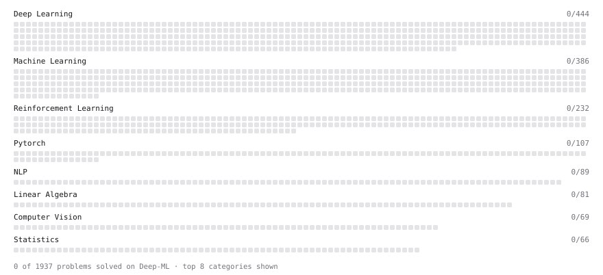

# Deep-ML

My machine learning practice from [Deep-ML](https://www.deep-ml.com). Every solution here was written by hand.

**25** solved · 0 problems · 9 labs · 16 math

[**Browse the interactive portfolio**](https://REEISH.github.io/deep-ml/) to replay this filling in over time.

## Labs

| | Difficulty | Solved | |
| --- | --- | --- | --- |
| [Design Your Own Activation Function](https://www.deep-ml.com/labs/9) | easy | 2026-10-18 | [solution](labs/0009-design-your-own-activation-function) |
| [PyTorch: Build a Complete Training Loop](https://www.deep-ml.com/labs/13) | easy | 2026-10-24 | [solution](labs/0013-pytorch-build-a-complete-training-loop) |
| [Train a Binary Classifier](https://www.deep-ml.com/labs/23) | easy | 2026-10-26 | [solution](labs/0023-train-a-binary-classifier) |
| [Train a Linear Regression Model](https://www.deep-ml.com/labs/18) | easy | 2026-10-26 | [solution](labs/0018-train-a-linear-regression-model) |
| [Data Preprocessing: Handling Missing Values](https://www.deep-ml.com/labs/11) | medium | 2026-10-26 | [solution](labs/0011-data-preprocessing-handling-missing-values) |
| [Design Your Own Optimizer (NumPy)](https://www.deep-ml.com/labs/8) | medium | 2026-10-22 | [solution](labs/0008-design-your-own-optimizer-numpy) |
| [Design Your Own PTQ](https://www.deep-ml.com/labs/36) | medium | 2026-11-07 | [solution](labs/0036-design-your-own-ptq) |
| [PyTorch: Implement Your Own Gradient Descent Training Step](https://www.deep-ml.com/labs/12) | medium | 2026-10-24 | [solution](labs/0012-pytorch-implement-your-own-gradient-descent-training-step) |
| [MNIST: Classification Loss (with Gradient)](https://www.deep-ml.com/labs/4) | hard | 2026-10-21 | [solution](labs/0004-mnist-classification-loss-with-gradient) |

## Math

| | Difficulty | Solved | |
| --- | --- | --- | --- |
| [Catastrophic Forgetting as Curvature-Weighted Displacement](https://www.deep-ml.com/math-problems/264) | easy | 2026-11-04 | [solution](math/0264-catastrophic-forgetting-as-curvature-weighted-displacement) |
| [Class Imbalance and Proper Scoring](https://www.deep-ml.com/math-problems/44) | easy | 2026-11-03 | [solution](math/0044-class-imbalance-and-proper-scoring) |
| [Measuring Continual Learners: The Accuracy Matrix, BWT and FWT](https://www.deep-ml.com/math-problems/266) | easy | 2026-11-04 | [solution](math/0266-measuring-continual-learners-the-accuracy-matrix-bwt-and-fwt) |
| [Model Selection: CV, AIC, and BIC](https://www.deep-ml.com/math-problems/43) | easy | 2026-10-27 | [solution](math/0043-model-selection-cv-aic-and-bic) |
| [Three Scenarios: Task-, Domain- and Class-Incremental Learning](https://www.deep-ml.com/math-problems/271) | easy | 2026-11-04 | [solution](math/0271-three-scenarios-task-domain-and-class-incremental-learning) |
| [Bias–Variance Decomposition](https://www.deep-ml.com/math-problems/39) | medium | 2026-10-27 | [solution](math/0039-bias-variance-decomposition) |
| [Logistic Regression as Maximum Likelihood](https://www.deep-ml.com/math-problems/40) | medium | 2026-10-26 | [solution](math/0040-logistic-regression-as-maximum-likelihood) |
| [Margins and Soft-Margin SVMs](https://www.deep-ml.com/math-problems/42) | medium | 2026-11-08 | [solution](math/0042-margins-and-soft-margin-svms) |
| [PPO Clipped Surrogate Objective](https://www.deep-ml.com/math-problems/53) | medium | 2026-11-08 | [solution](math/0053-ppo-clipped-surrogate-objective) |
| [Random Walks, PageRank and the Stationary Distribution](https://www.deep-ml.com/math-problems/188) | medium | 2026-11-04 | [solution](math/0188-random-walks-pagerank-and-the-stationary-distribution) |
| [Roofline: Time is the Max of Bytes/BW and FLOPs/Peak](https://www.deep-ml.com/math-problems/64) | medium | 2026-11-08 | [solution](math/0064-roofline-time-is-the-max-of-bytes-bw-and-flops-peak) |
| [Statistical Inference](https://www.deep-ml.com/math-problems/27) | medium | 2026-11-03 | [solution](math/0027-statistical-inference) |
| [The EM Algorithm](https://www.deep-ml.com/math-problems/41) | medium | 2026-11-03 | [solution](math/0041-the-em-algorithm) |
| [The Fourier Transform and the Convolution Theorem](https://www.deep-ml.com/math-problems/155) | medium | 2026-11-06 | [solution](math/0155-the-fourier-transform-and-the-convolution-theorem) |
| [The Graph Laplacian, Its Eigenvectors and Spectral Clustering](https://www.deep-ml.com/math-problems/189) | medium | 2026-11-04 | [solution](math/0189-the-graph-laplacian-its-eigenvectors-and-spectral-clustering) |
| [Probabilistic Models](https://www.deep-ml.com/math-problems/29) | hard | 2026-11-03 | [solution](math/0029-probabilistic-models) |

---

_This file is regenerated by Deep-ML on every push._
